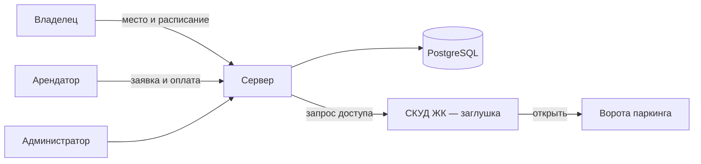

# Информационная система почасовой аренды парковочных мест в жилых комплексах

Выпускная квалификационная работа бакалавра.
МАИ, Институт №8, кафедра 806, направление 02.03.02 «Фундаментальная информатика и информационные технологии».

- **Автор:** Юхнев А.Д., группа М8О-412Б-23
- **Научный руководитель:** Лукин В.Н., к.ф.-м.н., доцент кафедры 806

## О проекте

В новых жилых комплексах машино-места часто покупают как инвестицию, и большую часть времени они пустуют. При этом жителям мест не хватает.

Система — площадка-посредник между владельцами машино-мест и арендаторами. Арендатор подаёт заявку на интервал времени в конкретном ЖК. Система сама назначает ему свободное место, принимает оплату и открывает доступ в паркинг через СКУД.

## Ключевая задача

Автоматическое назначение машино-мест по заявкам на интервалы:

- без пересечений интервалов на одном месте;
- корректно при одновременных запросах;
- с оценкой качества распределения на симуляции и сравнением с базовыми стратегиями.

## Роли

| Роль | Что делает |
|---|---|
| Владелец | публикует место и расписание доступности |
| Арендатор | подаёт заявку на интервал, оплачивает, открывает ворота с телефона |
| Администратор | модерация и контроль |

## Архитектура

API СКУД реального ЖК недоступен, поэтому в работе он заменён заглушкой.

## Стек

| Слой | Технологии |
|---|---|
| Сервер | Python, FastAPI |
| СУБД | PostgreSQL |
| Доступ к данным | SQLAlchemy, Alembic |
| Клиент | React Native / Expo (TypeScript) или Telegram Mini App — выбор на этапе технического документа |
| Интеграции | СКУД ЖК — заглушка API |

## Статус

| Этап | Срок | Состояние |
|---|---|---|
| Технический документ: сущности, БД, диаграммы, стек | октябрь 2026 | в работе |
| Реализация: сервер, клиент, заглушка СКУД, симуляция | после одобрения документа | не начата |
| Предзащита | апрель 2027 | — |
| Защита | июнь 2027 | — |

## Запуск

Инструкция появится вместе с кодом.
